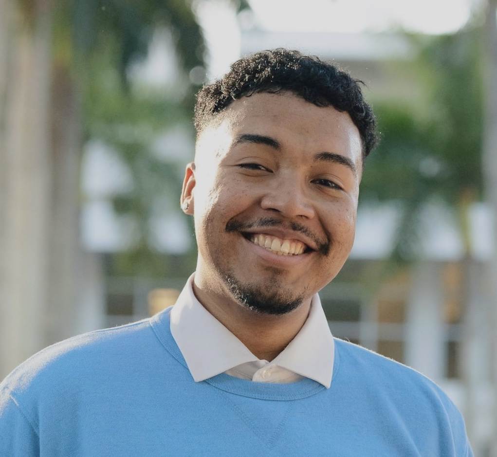

:::: {.landing-hero}

::: {.landing-photo}

:::
::: {.landing-text}
[MPH Candidate · Columbia Mailman School of Public Health]{.eyebrow}

# Emanuel Clemente

I’m Emanuel, a Master of Public Health candidate in Sociomedical Sciences at Columbia University’s Mailman School of Public Health. Originally from South Florida and from a Puerto Rican family, I’ve seen firsthand how social and structural inequities shape health and education, and that experience grounds my work at the intersections of medicine, law, and community health. My research focuses on incarceration, substance use, and harm reduction across New York State.

Alongside my research, I create under the name Saint Manu, working across visual art, graphic design, photography, and music curation. To me, both practices ask the same question: how do we make visible the conditions that shape people’s lives, and imagine something better? I believe public health should not only study inequity, but actively work to dismantle it.
:::
::::

:::: {.panes}
::: {.pane}
[01 // Academic Work]{.pane-index}

### [Research & Academic Experience](resume.html)

Research, experience, and teaching in harm reduction, maternal health, and health policy.
:::
::: {.pane}
[02 // Creative Work]{.pane-index}

### [Art Portfolio & Other Projects](saint_manu/index.html)

Visual art, graphic design, photography, and music curation as Saint Manu.
:::
::::